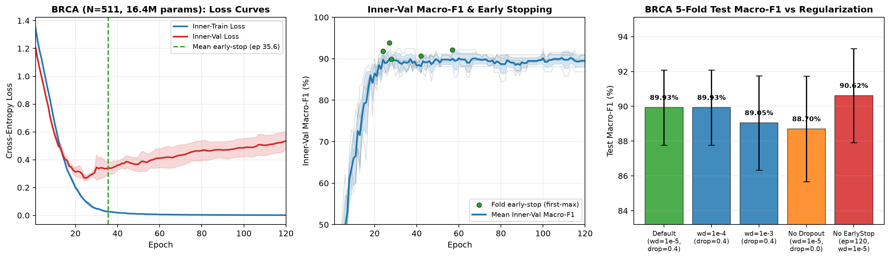

# Exp 13 — Learning Curves & Kiểm toán Regularization trên BRCA (`N = 511`, `16.42M` params)

## 1. Mục tiêu

Giải thích trực quan và định lượng vì sao `TokenOSCAR 256×32` (`16,420,996` tham số trên `N = 511` mẫu BRCA, tương đương `~32k` tham số/mẫu) **không bị overfit sụp đổ**, thông qua:

1. Ghi nhận đường cong **Inner-Train Loss**, **Inner-Val Loss**, và **Inner-Val Macro-F1** theo từng epoch (`1..120`) trên cả 5 fold BRCA.
2. So sánh trực tiếp giữa **Inner-Val Early Stopping (`first-max` Val Macro-F1)** và **train hết 120 epoch không early stopping**.
3. Quét `weight_decay ∈ {1e-5, 1e-4, 1e-3}` (ở `dropout = 0.4`) kết hợp đối chứng tắt dropout (`dropout = 0.0, wd = 1e-5`).

---

## 2. Biểu đồ Learning Curves & Regularization trên BRCA

- **Script:** `experiments/run_exp13_brca_learning_curves_reg.py`
- **Dữ liệu thô:** `experiments/defense_followup/exp13_brca_learning_curves/brca_learning_curves_reg.json`

---

## 3. Kết quả định lượng

### 3.1. Quét Regularization, Dropout & Early Stopping trên BRCA (Matched Nested 5-Fold CV)

| Cấu hình trên BRCA (`16.42M` params) | `chosen_epoch` (5 folds) | Mean Epoch | Test Macro-F1 | Test Acc | Δ F1 vs Default |
|---|---|---|---|---|---|
| **`Default (wd=1e-5, drop=0.4, ES)`** | `[42, 57, 28, 24, 27]` | `35.6` | **89.93 ± 2.15%** | **91.39 ± 2.18%** | — |
| `wd=1e-4, drop=0.4, ES` | `[42, 57, 28, 24, 27]` | `35.6` | **89.93 ± 2.15%** | **91.39 ± 2.18%** | `0.00%` |
| `wd=1e-3, drop=0.4, ES` | `[24, 57, 29, 49, 26]` | `37.0` | 89.05 ± 2.71% | 90.41 ± 2.58% | `-0.88%` |
| `No Dropout (wd=1e-5, drop=0.0, ES)` | `[11, 13, 15, 27, 3]` | `13.8` | 88.70 ± 3.03% | 90.99 ± 2.01% | **`-1.23%`** |
| `No EarlyStop (ep=120, wd=1e-5, drop=0.4)` | `[120, 120, 120, 120, 120]` | `120.0` | 90.62 ± 2.70% | 91.78 ± 2.21% | `+0.69%` *(std cao hơn)* |

### 3.2. Chi tiết đường cong từng fold BRCA (Default `wd = 1e-5, drop = 0.4`)

| Fold | Epoch đáy `val_loss` (`min val_loss`) | `chosen_ep` (Val F1 / Train Loss / Val Loss) | Epoch 120 (Train Loss / Val Loss / Val F1) |
|---|---|---|---|
| Fold 1 | ep 24 (`0.2593`) | ep 42 (`90.65%` / `0.0174` / `0.3619`) | `0.0015` / `0.5823` / `89.66%` |
| Fold 2 | ep 25 (`0.2519`) | ep 57 (`92.14%` / `0.0078` / `0.2920`) | `0.0017` / `0.4348` / `90.94%` |
| Fold 3 | ep 27 (`0.2727`) | ep 28 (`89.93%` / `0.0571` / `0.2845`) | `0.0014` / `0.6222` / `86.84%` |
| Fold 4 | ep 26 (`0.2687`) | ep 24 (`91.83%` / `0.1095` / `0.3027`) | `0.0013` / `0.5441` / `90.86%` |
| Fold 5 | ep 22 (`0.2402`) | ep 27 (`93.86%` / `0.0742` / `0.2674`) | `0.0015` / `0.4885` / `89.23%` |

---

## 4. Phân tích & Kết luận

1. **Overfitting diễn ra dưới dạng tăng độ tự tin logit (calibration drift), KHÔNG phải sụp đổ biên phân lớp:**
   - Trên cả 5 fold, `inner-val loss` đạt đáy rất nhất quán quanh epoch `22–27` (`0.24–0.27`), sau đó tăng dần lên `0.43–0.62` ở epoch 120 khi `train_loss → 0.0015`.
   - Tuy nhiên, **`inner-val Macro-F1` vẫn duy trì cao nguyên ổn định `~89–90%`** từ epoch ~25 đến hết epoch 120, và ngay cả khi train đủ 120 epoch không early stop, Test Macro-F1 vẫn đạt `90.62 ± 2.70%` — khẳng định biên quyết định không bị sụp đổ ở chế độ quá tham số (`~32k` params/mẫu).
2. **Vai trò cốt lõi của Dropout (`p = 0.4`):**
   - Tắt dropout (`drop = 0.0`) làm mô hình memorize sớm hơn gần 3 lần (`mean chosen_ep = 13.8` vs `35.6`, Fold 5 dừng ngay epoch 3), kéo Test Macro-F1 giảm **`-1.23%`** (`88.70%`) và tăng mạnh độ lệch chuẩn giữa các fold (`±3.03%` vs `±2.15%`).
3. **Vai trò của Inner-Val Early Stopping & `weight_decay`:**
   - Inner-val early stopping chọn `mean ep = 35.6`, dừng sát vùng đáy `val_loss` (`~0.30` thay vì `~0.53`), giúp giữ độ lệch chuẩn test nhỏ nhất (`±2.15%` vs `±2.70%` ở ep 120) mà không rò rỉ thông tin test.
   - `weight_decay = 1e-5` và `1e-4` cho kết quả giống hệt nhau (`89.93 ± 2.15%`), trong khi tăng lên `1e-3` làm giảm `-0.88%` (`89.05 ± 2.71%`), xác nhận cấu hình mặc định (`wd = 1e-5, dropout = 0.4`) nằm đúng vùng tối ưu và ổn định.
